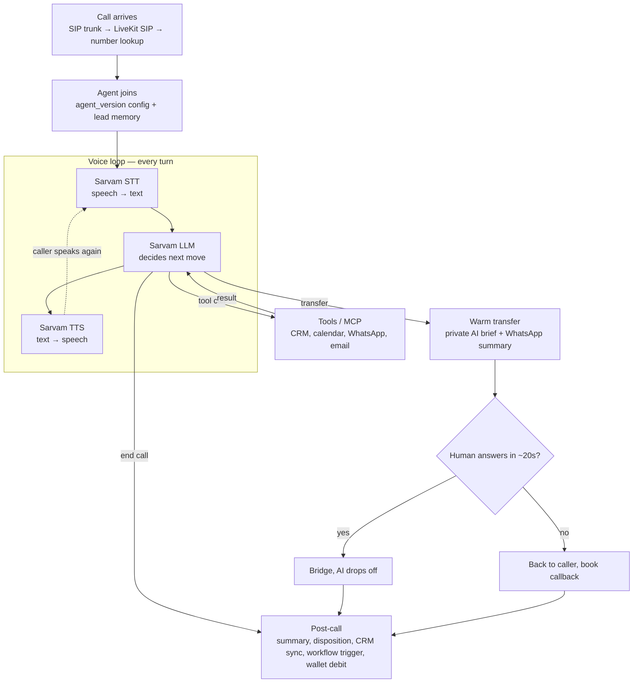

# Call Flow (approved 23 Oct 2026)

Mirror of Notion Vora2.0 › Architecture › Call Flow. Notion is the source of truth.

Everything runs in our LiveKit agent worker on AWS Mumbai. Sarvam supplies only STT, LLM and TTS through its API.

## Rules

- Time to first word and STT / LLM / TTS latency measured on every call.
- Recording: LiveKit Egress → S3 Mumbai, whole call, per-tenant prefix.
- Outbound: wallet check + scheduler slot before dial; answer detection before the agent speaks; pre-generated first line.
- Tool results return to the LLM before it speaks. Money-moving tools need caller verification, limits and an audit log.
- LLM behind a provider interface per agent (Sarvam default; fallback pending Decision Log).
- Every call stores `agent_version`.

## Capacity reality

Sarvam API limits, not the 1,000-channel trunk, set the call ceiling. Growth: 100 concurrent STT streams, 300 req/min on sarvam-105b. Enterprise limits requested (VORA2-7).
